<p align="center">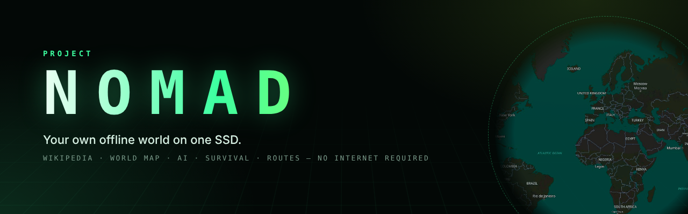</p>

<p align="center">
  
  
  
  
</p>

<p align="center"><b>Node for Offline Media, Archives and Data.</b><br>
All of Wikipedia, a map of the entire planet, a local AI, thousands of books, repair guides, medical references and survival tools —<br>
on one SSD, in one app, without an internet connection.</p>

<p align="center">
  <a href="https://github.com/mikeey77/nomad/releases/latest/download/NOMAD.exe"><b>⬇ Download NOMAD.exe</b></a> ·
  <a href="#-quick-start">Quick start</a> ·
  <a href="#-features">Features</a> ·
  <a href="#-whats-on-the-ssd">Storage guide</a>
</p>

---

<p align="center">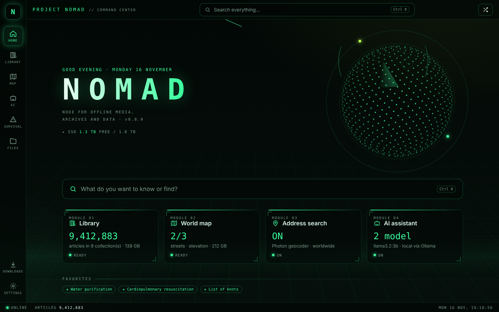</p>

## ✦ Features

<table>
<tr>
<td width="50%">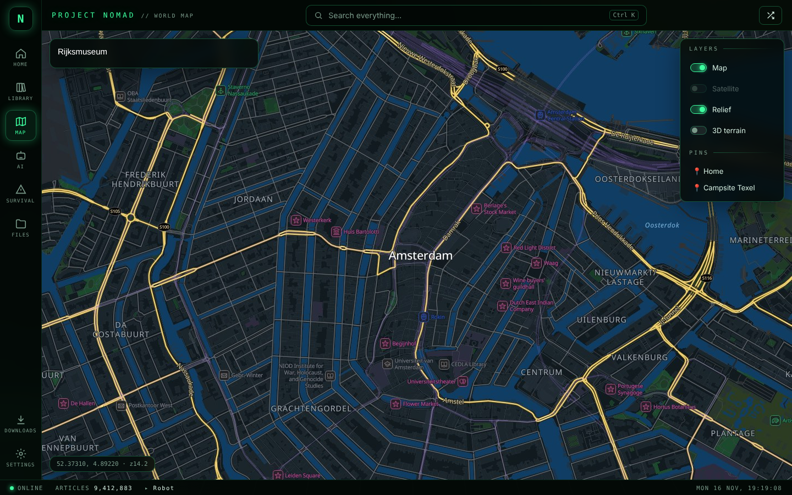</td>
<td width="50%"><h3>🗺️ World map</h3>
Every street, building and place name on Earth from OpenStreetMap, rendered locally from a single file.
Colorful night style (or accent / light), relief shading, 3D terrain, worldwide address search, pins and
<b>turn-by-turn routes</b> for car, bike and walking.</td>
</tr>
<tr>
<td width="50%"><h3>📚 Library</h3>
The complete English Wikipedia with images — plus any of 3,600+ Kiwix collections: Gutenberg books, iFixit,
Stack Exchange, medical encyclopedias, Khan Academy, TED talks and more.
Full-text search across everything, favorites, notes per article and reading history.</td>
<td width="50%">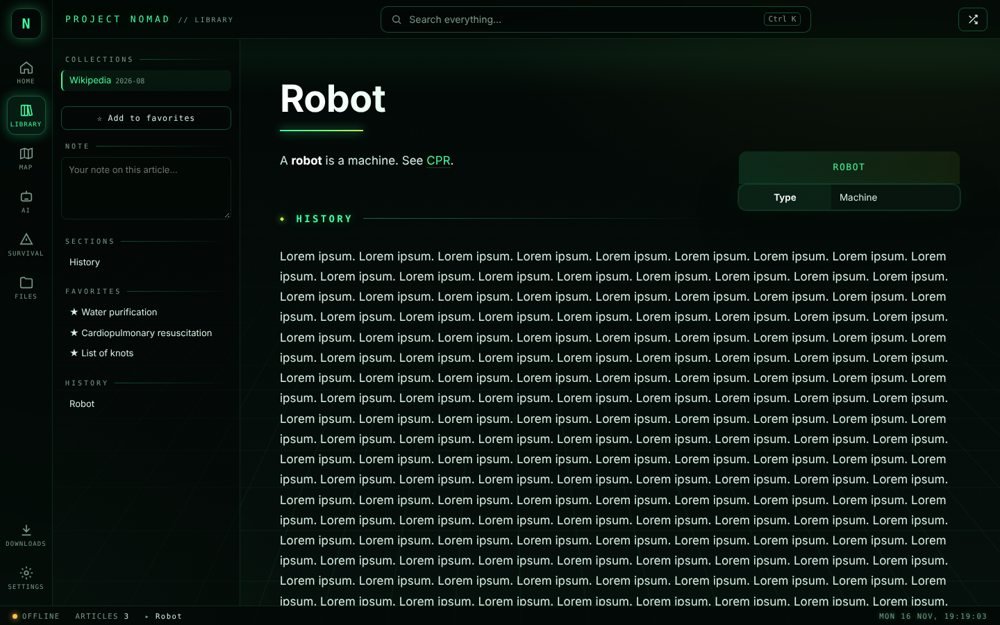</td>
</tr>
<tr>
<td width="50%">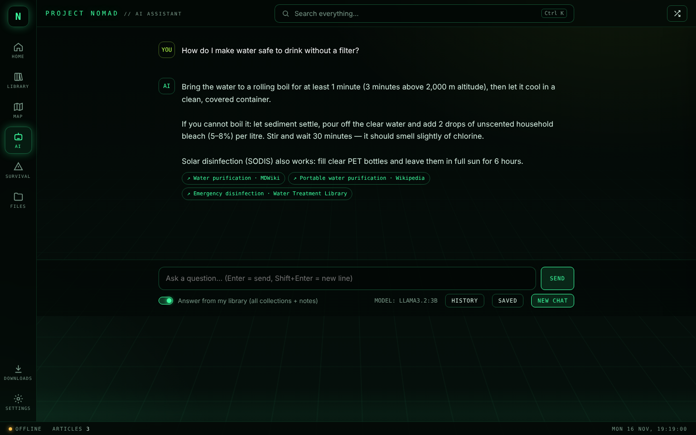</td>
<td width="50%"><h3>🤖 Local AI</h3>
A private assistant running on your own computer (Ollama). It searches <i>your</i> offline library first and
answers with sources you can open. Chats are temporary by default — save the ones you want, bookmark single answers.</td>
</tr>
<tr>
<td width="50%"><h3>🆘 Survival kit</h3>
One-tap first-aid and survival guides pulled from your medical and survival collections, SOS light-and-sound signal,
flashlight, GPS position, compass, sunrise/sunset and an emergency checklist.</td>
<td width="50%">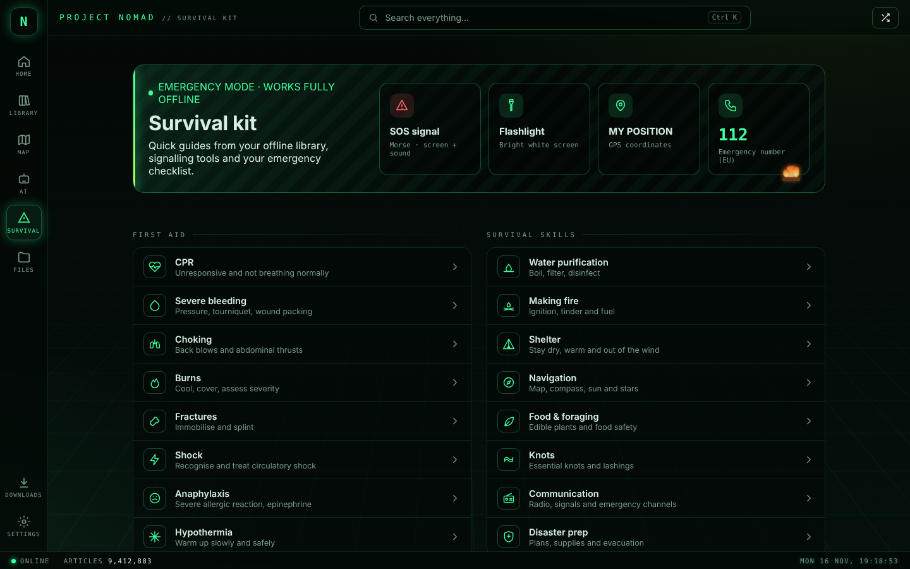</td>
</tr>
<tr>
<td width="50%">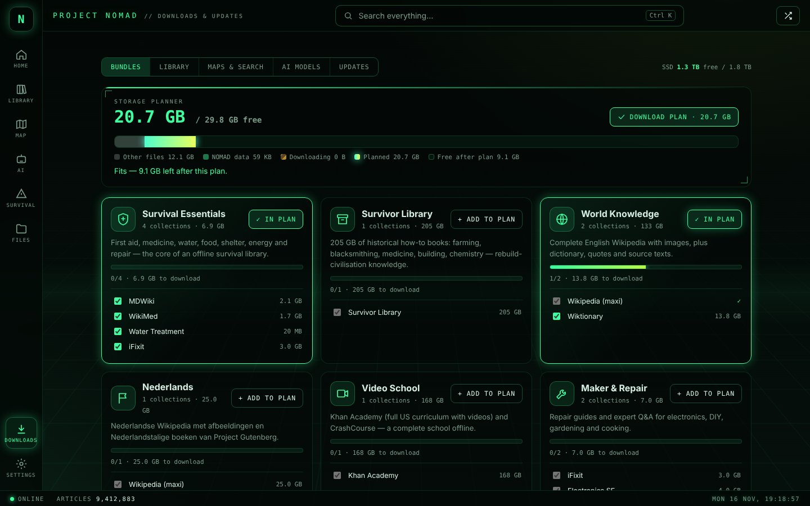</td>
<td width="50%"><h3>⬇️ Bundles & storage planner</h3>
Pick ready-made bundles — <i>Survival, World Knowledge, Health, Maker & Repair, Video School, Navigation…</i> —
and see instantly whether it all fits on your SSD. Downloads queue up, resume after interruptions and work the moment they finish.</td>
</tr>
<tr>
<td width="50%"><h3>📁 File manager</h3>
Browse the whole SSD inside the app, preview images, PDFs, video and audio, edit text files, upload, rename and delete.
Files you copy in by hand are detected automatically.</td>
<td width="50%">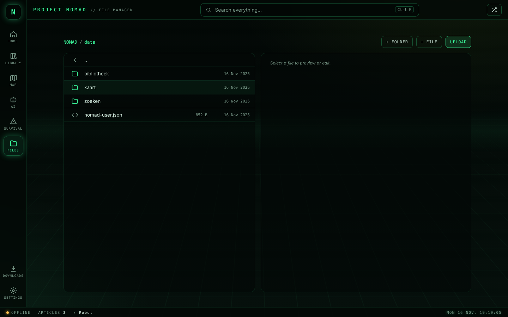</td>
</tr>
</table>

### And the small stuff
- 📱 **Phone & iPad** — scan the QR code on the dashboard, add NOMAD to your home screen, use it over Wi-Fi.
- 📴 **NOMAD Mobile, no PC needed** — `NOMAD-mobile.html` is one self-contained file: open it on your phone, pick your `.zim` and `world.pmtiles` files, and read, search and browse the map straight from the SSD. Also installable from [mikeey77.github.io/nomad/mobile](https://mikeey77.github.io/nomad/mobile/).
- 🎒 **Inventory** — track your real supplies game-style: home, backpack, car and your own stashes, 180+ items with emoji and rarity, days of food & water for your household, expiry warnings, recommended kits (72-hour bag, 2-week home supply, car kit) and *where to find* any item on the map.
- 🔌 **Plug & go (Windows)** — the SSD shows up with the NOMAD icon, and an optional helper asks to open NOMAD (or opens it) as soon as you plug the SSD in.
- 📱 **Phones & tablets** — NOMAD Mobile adapts to iPad/tablet screens (side rail, two-column library, side panel on the map) and shows your inventory read-only.
- 📍 **Places on the map** — fuel, EV charging, hospitals, pharmacies, supermarkets, parking, water, camping… as toggles, with a *Nearby* list sorted by distance. Straight from the map data, no extra download.
- 🔖 **Reading list & favorites**, also on your phone. **Sync through the SSD** — no Wi-Fi, no cloud: the phone reads `data/nomad-user.json`, and phone changes go back via `data/inbox`.
- ⚡ **Fast AI** — searches all collections in parallel with live progress, keeps the model warm, and has a **Think** mode for harder questions.
- 🔄 **Self-updating** — the app and NOMAD.exe update themselves from GitHub; a banner offers a one-click restart.
- 🌍 **English & Nederlands**, four accent colors, dark & light theme, adjustable text size.
- ✨ Boot sequence, rotating globe, a campfire in the survival kit, the occasional shooting star… and maybe something hidden if you know the right code.

## 🗺️ The map

<table>
<tr>
<td>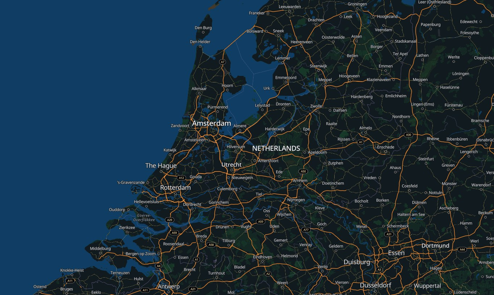<p align="center"><sub>Country view</sub></p></td>
<td>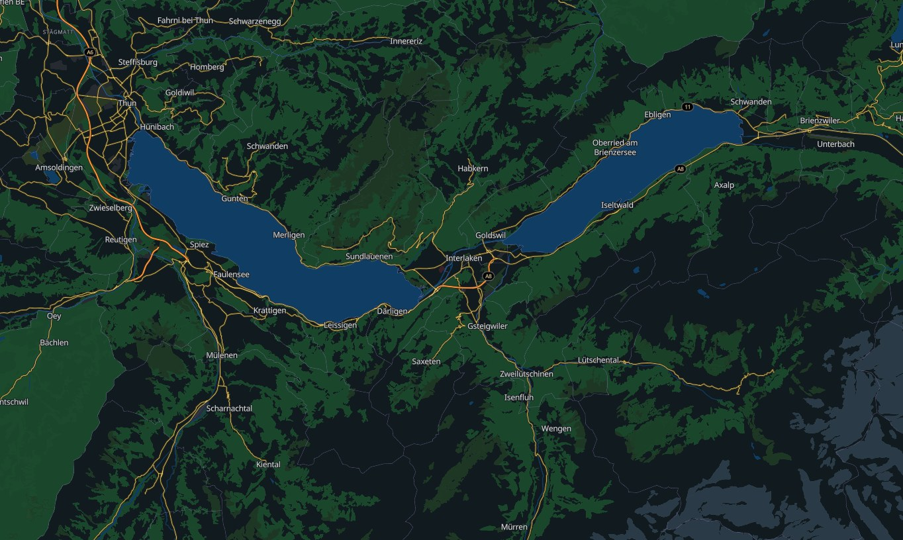<p align="center"><sub>Lakes, forests & mountain roads</sub></p></td>
</tr>
<tr>
<td>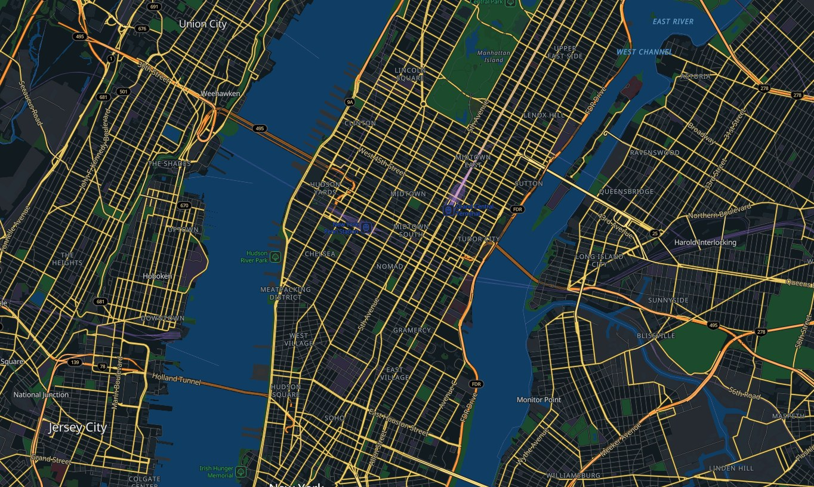<p align="center"><sub>City detail</sub></p></td>
<td>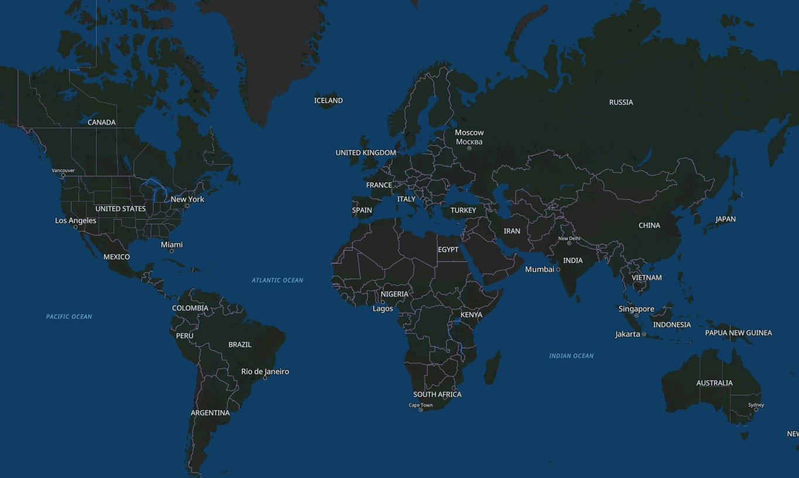<p align="center"><sub>The whole planet — one 120 GB file</sub></p></td>
</tr>
</table>

Motorways are orange, main roads yellow, railways purple, water blue and parks & forests green — readable at a glance, easy on the eyes at night.

## 🚀 Quick start

1. **Prepare the SSD** — format it as **exFAT** if you also want to use it on a phone later.
2. **Download** this repository (**Code → Download ZIP**) and unzip it to the root of the SSD as `NOMAD\`.
3. **Download [NOMAD.exe](https://github.com/mikeey77/nomad/releases/latest/download/NOMAD.exe)** into that `NOMAD\` folder and double-click it.
   The first run installs everything it needs into `NOMAD\tools` (portable Python, Ollama + an AI model, Java, Photon).
4. Open **Downloads → Bundles**, pick what you want and press **Download plan**.

> Windows SmartScreen may warn about an unsigned app: click **More info → Run anyway**.
> When Windows asks about network access, allow **private networks** so your phone can connect.

## 💾 What's on the SSD

| Content | Size | Folder |
|---|---:|---|
| Wikipedia (English, with images) | ~119 GB | `data\library` |
| World map (OpenStreetMap) | ~120 GB | `data\maps\world\world.pmtiles` |
| Elevation / 3D terrain | ~91 GB | `data\maps\terrain\terrain.pmtiles` |
| Worldwide address search | ~95 GB | `data\search\photon_data` |
| Survival Essentials bundle | ~9 GB | `data\library` |
| Project Gutenberg (70k books) | ~206 GB | `data\library` |
| Khan Academy (video) | ~168 GB | `data\library` |
| Route planning, Benelux | ~3 GB | `data\route` |
| AI models | 1–5 GB each | `ai\models` |

A practical "everything important" setup is roughly **450–600 GB**, leaving plenty of room on 2 TB for books, video and more.

```
NOMAD\
├─ NOMAD.exe            start here
├─ app\                 the application (this repo, self-updating)
├─ data\
│  ├─ library\          .zim collections (Wikipedia, books, guides…)
│  ├─ maps\             world.pmtiles · terrain.pmtiles · satellite.pmtiles
│  ├─ search\           address search database
│  └─ route\            route planning data
├─ ai\models\           local AI models
├─ tools\               portable Python, Ollama, Java, Photon, GraphHopper
└─ downloads\           partial downloads, logs, old versions
```

## 🧩 How it works

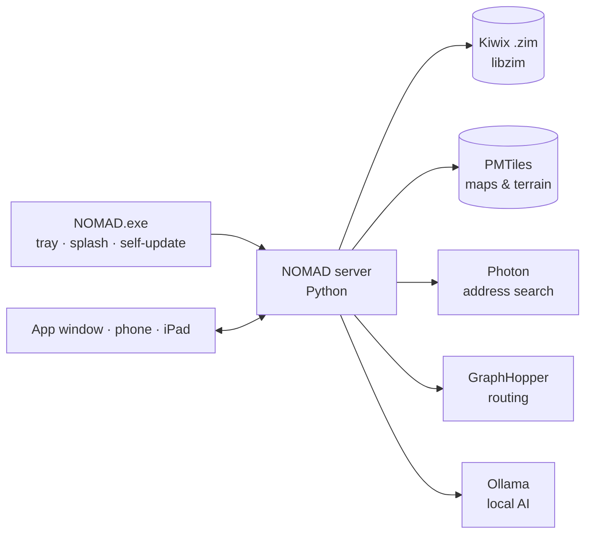

Everything runs locally on your machine. NOMAD only goes online when you ask it to download or update something.

## 🙏 Built on

[Kiwix / openZIM](https://kiwix.org) · [OpenStreetMap](https://www.openstreetmap.org/copyright) · [Protomaps](https://protomaps.com) ·
[MapLibre](https://maplibre.org) · [JAXA AW3D30](https://earth.jaxa.jp/en/data/policy/) · [Photon](https://github.com/komoot/photon) ·
[GraphHopper](https://www.graphhopper.com) · [Ollama](https://ollama.com) — and inspired by Crosstalk Solutions' Project N.O.M.A.D.

Map data © OpenStreetMap contributors (ODbL). Content collections keep their own licenses.

<sub>Medical and survival content is for reference only and is no substitute for professional help. In an emergency, call 112.</sub>
